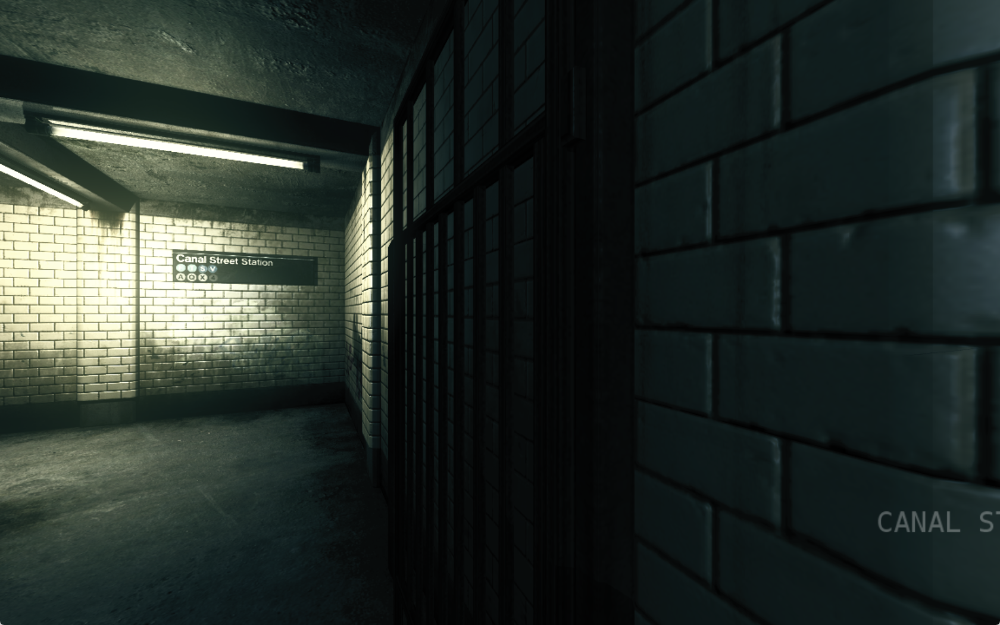
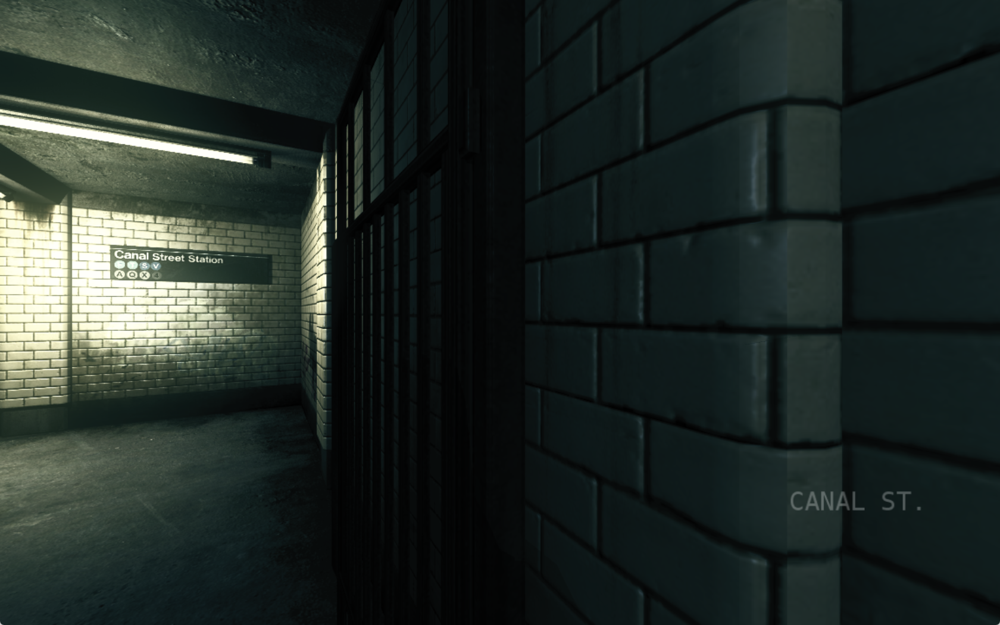
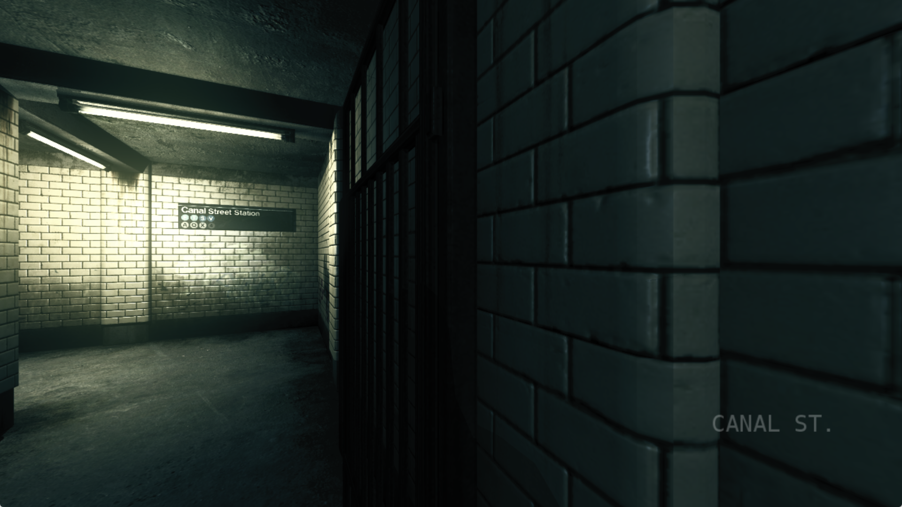

The character/location title renderer right-aligns names at x=790 on an authored 853x480 canvas. Its two HUD callers bypassed the existing narrow-display title transform. At 1680x1050, the height-based scale put that right edge near x=1728, outside the screen.

The correction applies the existing title fit to those two callers. The original guest painter supplies the text, metrics, fade and clipping; its borrowed matrix is restored after each draw.

These original game-window PNGs show the same saved start and exit-door approach at 1680x1050 output (1152x720 render/guest). The baseline cuts off the lower-right CANAL ST. label; the candidate shows it completely. Camera position and capture phase differ slightly.

Before:

After:

The candidate also shows the complete label at 1920x1080 output (1280x720 render/guest):

Both omitted call paths have a failing-before/passing-after regression. The new contract covers 48 cases through the original guest painter, including narrow, 16:9 and ultrawide modes, ASCII/UTF-16, fading, proportional glyph transforms and restored state. All five affected title/subtitle CTests pass. Independent correctness/regression review found no actionable issues.

Gameplay proof uses an English location label; the Russian Enzo scene and focused-character variant were not separately captured. The 4:3 and ultrawide checks use the guest-painter fixture. Binary identities, image hashes and validation scope are recorded in [proof.json](proof.json).
